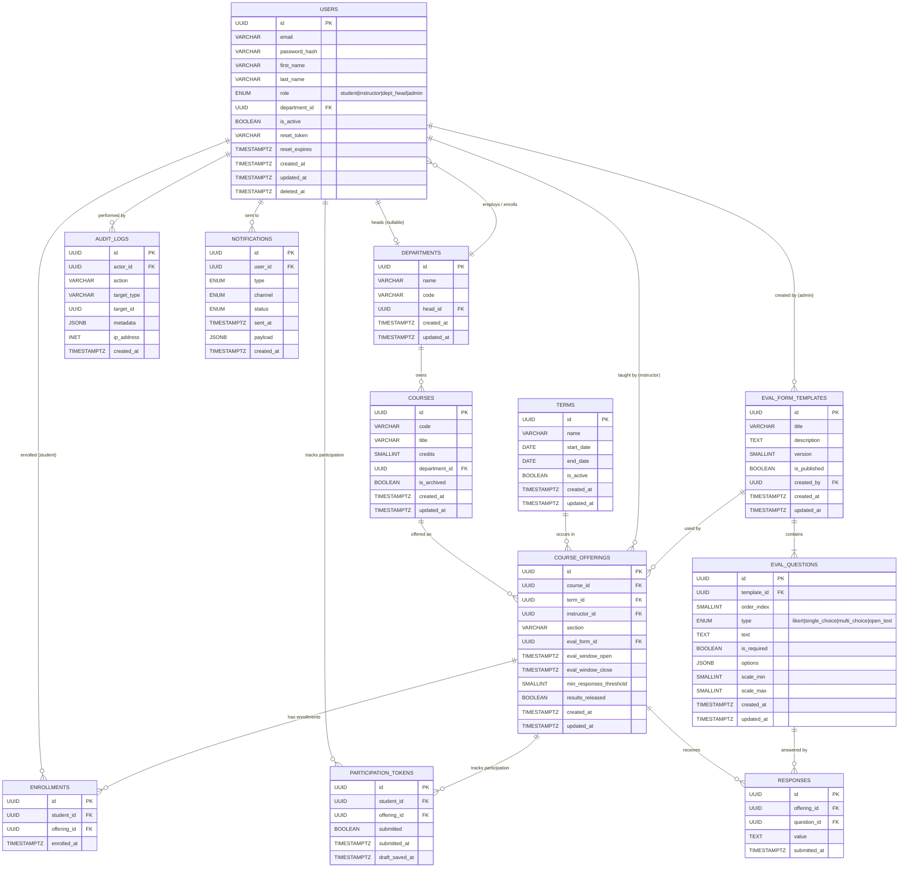
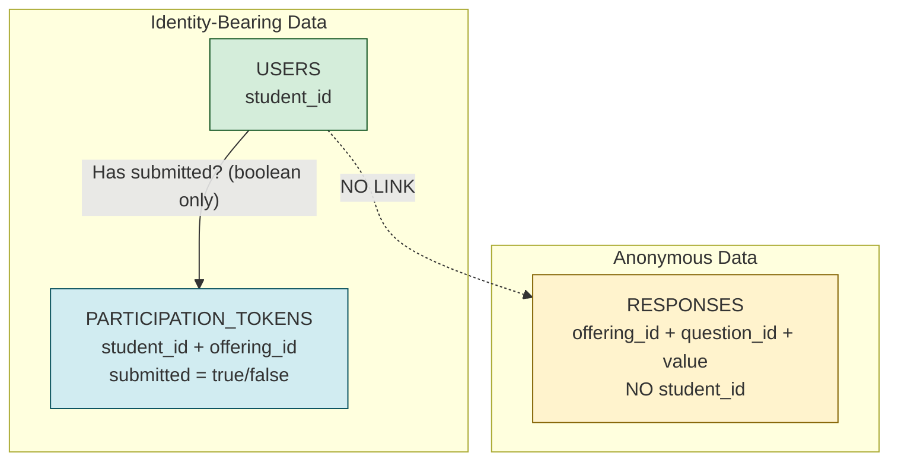
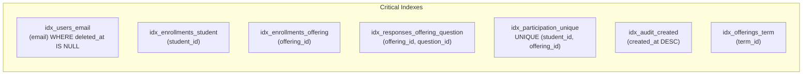

# 07 — Database Entity-Relationship Diagram

**Project:** University Course Evaluation System (UCES)  
**Phase:** 2 — System Design  
**Document Version:** 1.0

> Diagrams are written in [Mermaid](https://mermaid.js.org/) syntax. Render them in any Mermaid-compatible viewer (GitHub, VS Code Mermaid extension, mermaid.live).

---

## ER Diagram

---

## Privacy Separation Diagram

The following diagram highlights the **anonymity boundary** — the intentional absence of a relationship between `PARTICIPATION_TOKENS` and `RESPONSES`:

> **Key design invariant:** There is no foreign key, no shared UUID, and no derived field that connects a row in `RESPONSES` to a row in `PARTICIPATION_TOKENS` or to a `USERS` record. This is enforced at the database schema level, not merely by application policy.

---

## Indexes Summary

