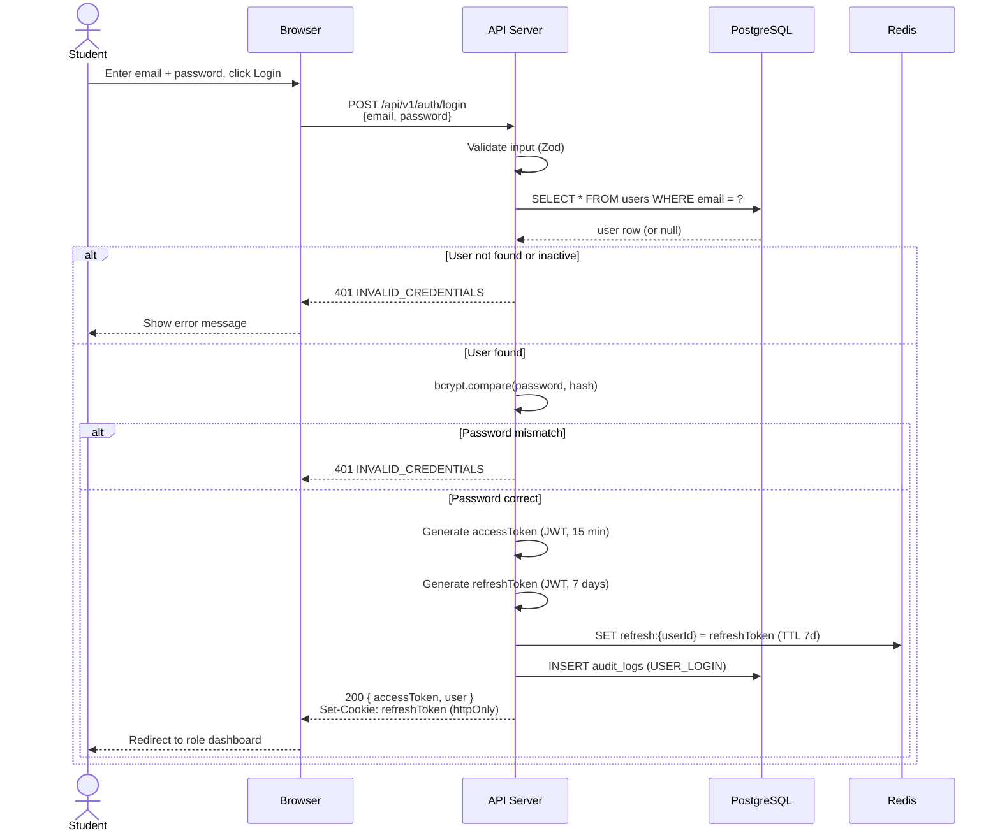
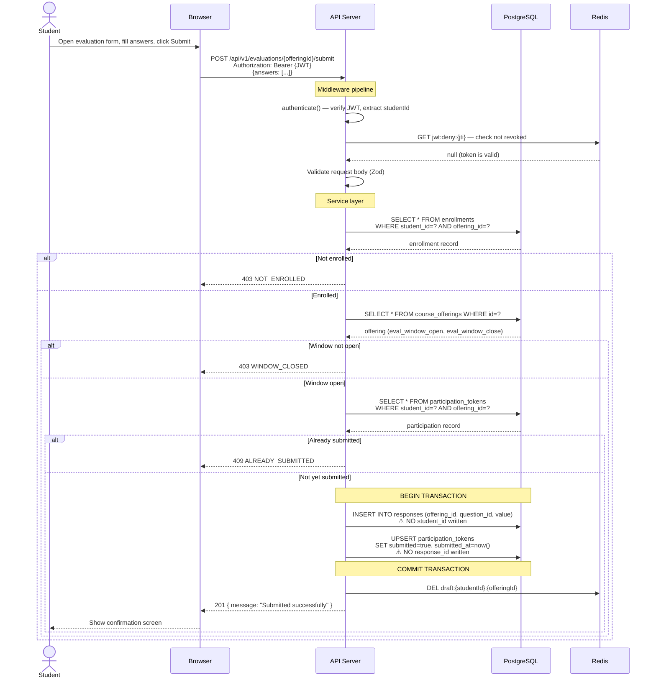
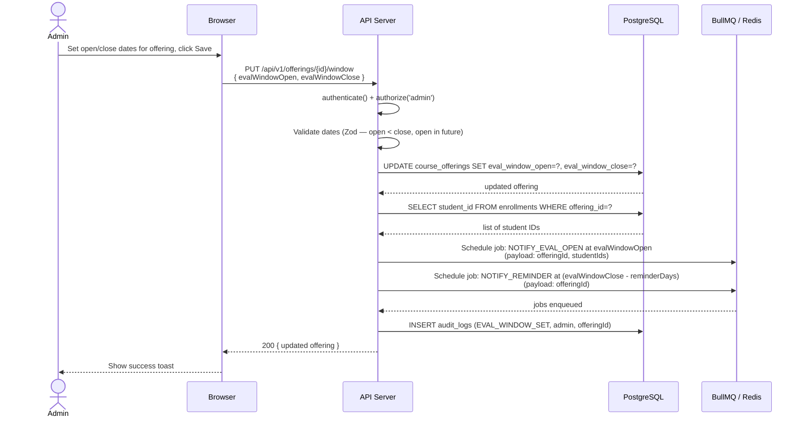
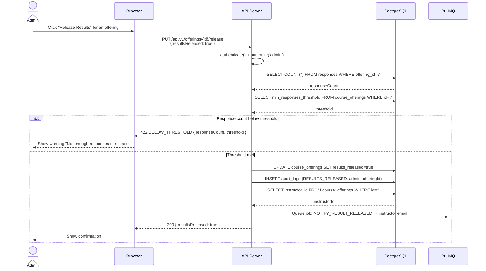
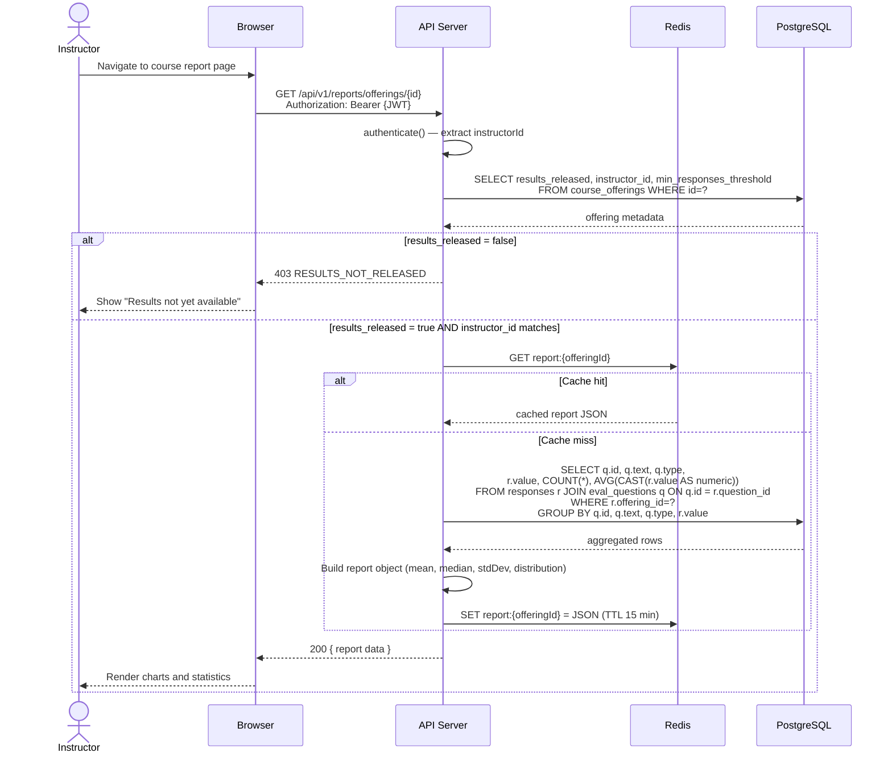
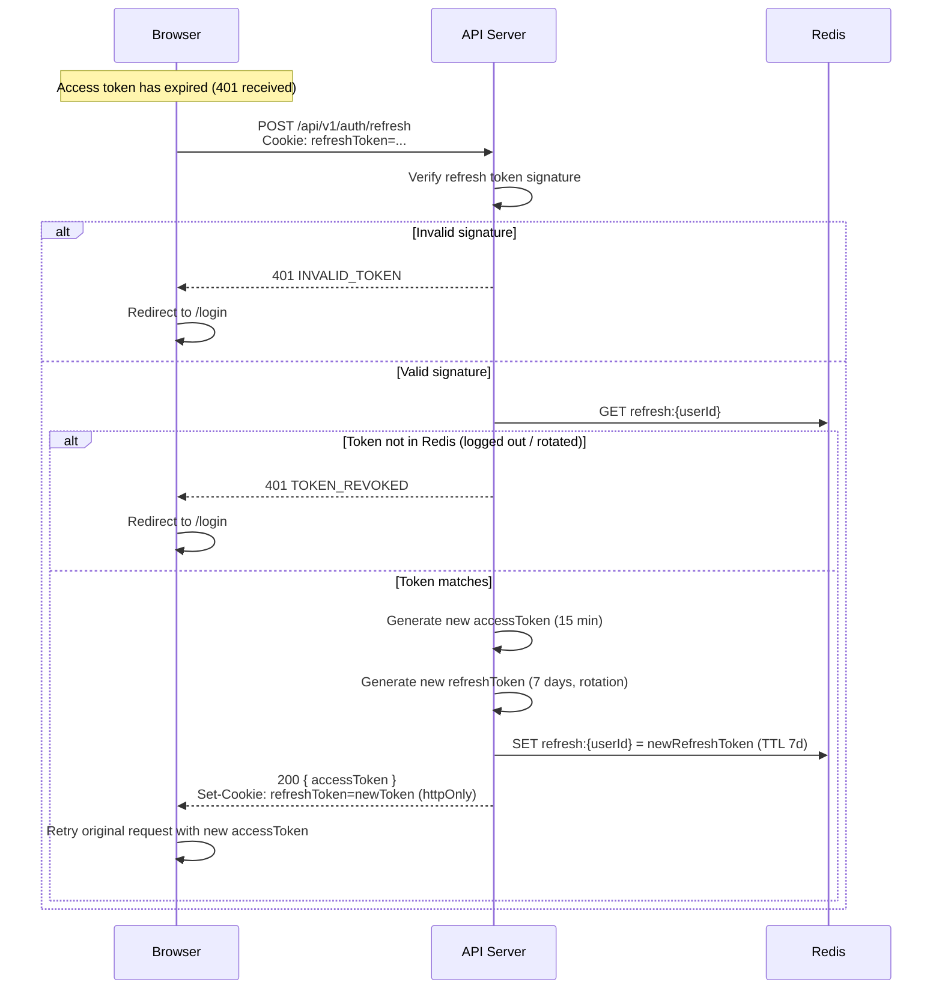
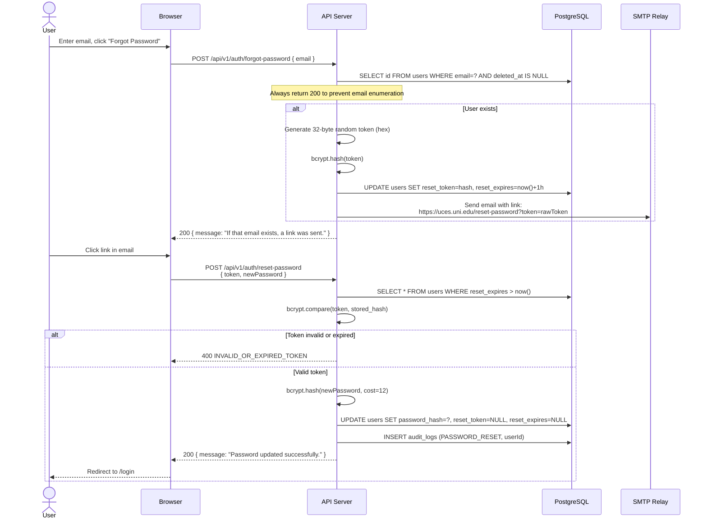

# 08 — Sequence Diagrams

**Project:** University Course Evaluation System (UCES)  
**Phase:** 2 — System Design  
**Document Version:** 1.0

> All diagrams use [Mermaid](https://mermaid.js.org/) `sequenceDiagram` syntax.

---

## SD-01: User Login

---

## SD-02: Anonymous Evaluation Submission

This is the **most security-critical** flow in the system.

---

## SD-03: Admin Sets Evaluation Window

---

## SD-04: Admin Releases Results to Instructor

---

## SD-05: Instructor Views Aggregated Report

---

## SD-06: Token Refresh Flow

---

## SD-07: Password Reset Flow

