# 09 — Use Case Diagram

**Project:** University Course Evaluation System (UCES)  
**Phase:** 2 — System Design  
**Document Version:** 1.0

> Diagrams use [Mermaid](https://mermaid.js.org/) syntax. The `flowchart` directive is used to represent UML Use Case diagrams since Mermaid does not yet have a native `usecaseDiagram` type.

---

## Full System Use Case Diagram

```mermaid
flowchart LR
    %% ─── Actors ───────────────────────────────
    STU(["👤 Student"])
    INS(["👤 Instructor"])
    DH(["👤 Department Head"])
    ADM(["👤 Admin"])

    %% ─── System Boundary ──────────────────────
    subgraph UCES["🖥  University Course Evaluation System"]

        %% Shared
        UC01(["UC-01\nLogin / SSO"])
        UC02(["UC-02\nLogout"])
        UC03(["UC-03\nReset Password"])
        UC04(["UC-04\nView Own Profile"])

        %% Student
        UC05(["UC-05\nView Pending Evaluations"])
        UC06(["UC-06\nView Evaluation Form"])
        UC07(["UC-07\nSave Evaluation Draft"])
        UC08(["UC-08\nSubmit Evaluation\n(Anonymous)"])
        UC09(["UC-09\nView Submission Status"])

        %% Instructor
        UC10(["UC-10\nView Own Course Reports"])
        UC11(["UC-11\nExport Course Report\n(PDF / CSV)"])

        %% Department Head
        UC12(["UC-12\nView Department Dashboard"])
        UC13(["UC-13\nView Instructor Summaries"])
        UC14(["UC-14\nExport Department Report"])

        %% Admin — User Management
        UC15(["UC-15\nManage Users (CRUD)"])
        UC16(["UC-16\nBulk Import Users (CSV)"])

        %% Admin — Academic Setup
        UC17(["UC-17\nManage Departments"])
        UC18(["UC-18\nManage Terms"])
        UC19(["UC-19\nManage Courses"])
        UC20(["UC-20\nManage Course Offerings"])
        UC21(["UC-21\nManage Enrollments"])

        %% Admin — Form Builder
        UC22(["UC-22\nCreate/Edit Form Template"])
        UC23(["UC-23\nAdd / Reorder Questions"])
        UC24(["UC-24\nPublish Form Template"])
        UC25(["UC-25\nClone Form Template"])

        %% Admin — Evaluation Management
        UC26(["UC-26\nConfigure Evaluation Window"])
        UC27(["UC-27\nRelease / Restrict Results"])
        UC28(["UC-28\nTrigger Notifications"])

        %% Admin — Reporting & Compliance
        UC29(["UC-29\nView Institution Dashboard"])
        UC30(["UC-30\nView Audit Logs"])
        UC31(["UC-31\nExport Audit Logs"])
        UC32(["UC-32\nConfigure Data Retention"])
    end

    %% ─── Actor → Use Case Associations ────────

    STU --> UC01 & UC02 & UC03 & UC04
    STU --> UC05 & UC06 & UC07 & UC08 & UC09

    INS --> UC01 & UC02 & UC03 & UC04
    INS --> UC10 & UC11

    DH  --> UC01 & UC02 & UC03 & UC04
    DH  --> UC12 & UC13 & UC14

    ADM --> UC01 & UC02 & UC03 & UC04
    ADM --> UC15 & UC16
    ADM --> UC17 & UC18 & UC19 & UC20 & UC21
    ADM --> UC22 & UC23 & UC24 & UC25
    ADM --> UC26 & UC27 & UC28
    ADM --> UC29 & UC30 & UC31 & UC32

    %% ─── Include / Extend ──────────────────────
    UC08 -.->|"«include»"| UC06
    UC07 -.->|"«extend»"| UC06
    UC11 -.->|"«include»"| UC10
    UC14 -.->|"«include»"| UC12
    UC23 -.->|"«include»"| UC22
    UC24 -.->|"«extend»"| UC22
    UC27 -.->|"«include»"| UC26

    %% ─── Styles ────────────────────────────────
    classDef actor     fill:#dbeafe,stroke:#3b82d4,color:#1e3a5f,font-weight:bold
    classDef usecase   fill:#f0fdf4,stroke:#16a34a,color:#14532d
    classDef shared    fill:#faf5ff,stroke:#7c3aed,color:#4c1d95
    classDef system    fill:#f7f8fa,stroke:#e5e7eb

    class STU,INS,DH,ADM actor
    class UC01,UC02,UC03,UC04 shared
    class UC05,UC06,UC07,UC08,UC09,UC10,UC11,UC12,UC13,UC14 usecase
    class UC15,UC16,UC17,UC18,UC19,UC20,UC21,UC22,UC23,UC24,UC25,UC26,UC27,UC28,UC29,UC30,UC31,UC32 usecase
```

---

## Use Case Detail Table

| UC ID | Use Case Name | Actor(s) | Precondition | Postcondition |
|---|---|---|---|---|
| UC-01 | Login / SSO | All | User account active | JWT pair issued; session started |
| UC-02 | Logout | All | Authenticated | JWT revoked; cookie cleared |
| UC-03 | Reset Password | All | Valid institutional email | New password hashed and saved |
| UC-04 | View Own Profile | All | Authenticated | Profile data displayed |
| UC-05 | View Pending Evaluations | Student | Authenticated; evaluation window open | List of pending evaluations shown |
| UC-06 | View Evaluation Form | Student | Enrolled in offering; window open | Form rendered with questions |
| UC-07 | Save Evaluation Draft | Student | Form opened | Partial answers saved to Redis |
| UC-08 | Submit Evaluation (Anonymous) | Student | Enrolled; window open; not yet submitted | Responses stored anonymously; participation token set |
| UC-09 | View Submission Status | Student | Authenticated | Shows submitted / pending per course |
| UC-10 | View Own Course Reports | Instructor | results_released = true; threshold met | Aggregated report displayed |
| UC-11 | Export Course Report | Instructor, Dept Head, Admin | Report visible | PDF or CSV generated and downloaded |
| UC-12 | View Department Dashboard | Dept Head, Admin | Authenticated with correct role | Department KPIs and comparison data |
| UC-13 | View Instructor Summaries | Dept Head, Admin | Department data exists | Instructor performance summary |
| UC-14 | Export Department Report | Dept Head, Admin | Dashboard visible | PDF or CSV downloaded |
| UC-15 | Manage Users | Admin | Authenticated as admin | User created / updated / deactivated |
| UC-16 | Bulk Import Users | Admin | Valid CSV file | Users provisioned |
| UC-17 | Manage Departments | Admin | Authenticated as admin | Department records updated |
| UC-18 | Manage Terms | Admin | Authenticated as admin | Term record saved |
| UC-19 | Manage Courses | Admin | Authenticated as admin | Course record saved |
| UC-20 | Manage Course Offerings | Admin | Course and term exist | Offering created with instructor assigned |
| UC-21 | Manage Enrollments | Admin | Offering exists | Student enrollment updated |
| UC-22 | Create/Edit Form Template | Admin | Template in draft state | Template saved |
| UC-23 | Add / Reorder Questions | Admin | Template in draft state | Question list updated |
| UC-24 | Publish Form Template | Admin | Template complete | Template locked; assignable to offerings |
| UC-25 | Clone Form Template | Admin | Template exists | New draft copy created |
| UC-26 | Configure Evaluation Window | Admin | Offering exists | Window open/close dates saved; jobs scheduled |
| UC-27 | Release / Restrict Results | Admin | Response count ≥ threshold | results_released flag toggled |
| UC-28 | Trigger Notifications | Admin | Users and offering exist | Notification jobs queued |
| UC-29 | View Institution Dashboard | Admin | Data exists | Institution-wide KPIs displayed |
| UC-30 | View Audit Logs | Admin | Authenticated as admin | Audit entries displayed |
| UC-31 | Export Audit Logs | Admin | Audit log queried | CSV file downloaded |
| UC-32 | Configure Data Retention | Admin | Authenticated as admin | Retention policy saved |

---

## Student Evaluation Submission — Use Case Specification

**Use Case ID:** UC-08  
**Name:** Submit Evaluation (Anonymous)  
**Actor:** Student  
**Priority:** High  

**Preconditions:**
1. Student is authenticated.
2. Student is enrolled in the course offering.
3. Evaluation window is currently open.
4. Student has not previously submitted this evaluation.

**Main Success Scenario:**
1. Student navigates to their evaluation list (UC-05).
2. Student opens the evaluation form for a course (UC-06).
3. Student answers all required questions.
4. Student optionally saves a draft (UC-07 — extend).
5. Student clicks "Submit".
6. System validates all required questions are answered.
7. System begins a database transaction:
   - Writes answer rows to `responses` table (no student_id).
   - Upserts `participation_tokens` row (submitted = true).
8. System commits transaction.
9. System deletes draft from Redis.
10. System displays confirmation message.

**Alternative Flows:**
- **3a.** Required question skipped → System highlights unanswered questions; prevents submission.
- **4a.** Window closes during draft → On submit attempt, system returns 403 WINDOW_CLOSED.
- **7a.** Duplicate submission detected (race condition) → Transaction rolls back; system returns 409 ALREADY_SUBMITTED.

**Postconditions:**
- Response data stored with no student linkage.
- Participation token records student submitted = true.
- Student cannot submit again for this offering.

**Business Rules:**
- BR-01: One submission per student per offering.
- BR-02: No student_id written to responses table.
- BR-03: Submission only accepted within the evaluation window.
