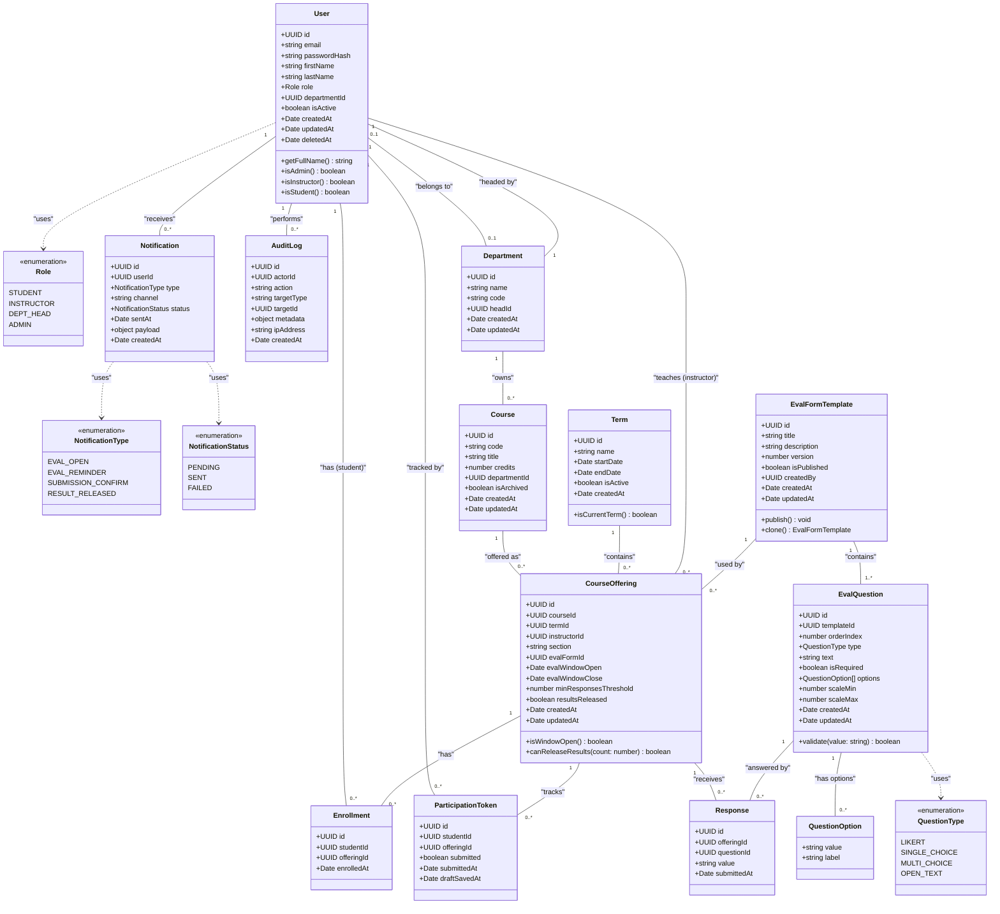
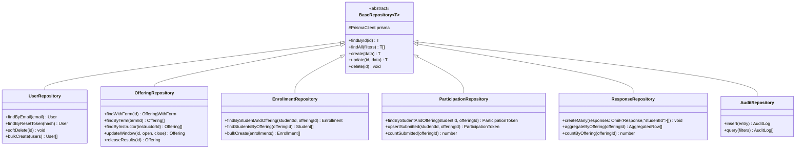

# 10 — Class Diagram

**Project:** University Course Evaluation System (UCES)  
**Phase:** 2 — System Design  
**Document Version:** 1.0

> Diagrams use [Mermaid](https://mermaid.js.org/) `classDiagram` syntax.

---

## 1. Domain Model Class Diagram

The class diagram represents the server-side domain model as implemented in TypeScript service and repository layers, aligned with the Prisma schema.

---

## 2. Service Layer Class Diagram

```mermaid
classDiagram

    %% ─── Auth Module ─────────────────────────────────────────────

    class AuthService {
        -UserRepository userRepo
        -RedisService redis
        -AuditService audit
        +login(email, password) TokenPair
        +logout(userId, jti) void
        +refreshToken(token) TokenPair
        +forgotPassword(email) void
        +resetPassword(token, newPassword) void
        -generateTokenPair(user) TokenPair
        -verifyRefreshToken(token) JWTPayload
    }

    %% ─── User Module ─────────────────────────────────────────────

    class UserService {
        -UserRepository userRepo
        -AuditService audit
        +list(filters, pagination) PagedResult~User~
        +findById(id) User
        +create(dto) User
        +update(id, dto) User
        +softDelete(id) void
        +bulkImport(csv) ImportResult
    }

    %% ─── Evaluation Module ───────────────────────────────────────

    class EvaluationService {
        -EnrollmentRepository enrollRepo
        -OfferingRepository offeringRepo
        -ParticipationRepository participRepo
        -ResponseRepository responseRepo
        -RedisService redis
        -AuditService audit
        +getPendingEvaluations(studentId) Offering[]
        +getForm(offeringId) EvalForm
        +saveDraft(studentId, offeringId, answers) void
        +submit(studentId, offeringId, answers) void
        +getStatus(studentId, offeringId) SubmissionStatus
        -validateWindow(offering) void
        -validateEnrollment(studentId, offeringId) void
        -validateNotSubmitted(studentId, offeringId) void
    }

    %% ─── Reports Module ──────────────────────────────────────────

    class ReportService {
        -ResponseRepository responseRepo
        -OfferingRepository offeringRepo
        -RedisService redis
        -ExportService exportService
        +getOfferingReport(offeringId, requesterId) OfferingReport
        +getInstructorReport(instructorId, termId) InstructorReport
        +getDepartmentReport(deptId, termId) DepartmentReport
        +getInstitutionDashboard() InstitutionDashboard
        +exportReport(offeringId, format) Buffer
        -checkResultsAccess(offering, requesterId) void
        -computeStats(values) Stats
    }

    %% ─── Notification Module ─────────────────────────────────────

    class NotificationService {
        -NotificationRepository notifRepo
        -EmailTransport email
        -BullQueue queue
        +scheduleEvalOpen(offeringId, openAt, studentIds) void
        +scheduleReminder(offeringId, reminderAt, studentIds) void
        +sendResultReleased(instructorId, offeringId) void
        +processQueue() void
        -sendEmail(to, subject, body) void
    }

    %% ─── Audit Module ────────────────────────────────────────────

    class AuditService {
        -AuditRepository auditRepo
        +log(entry: AuditEntry) void
        +query(filters, pagination) PagedResult~AuditLog~
        +export() Buffer
    }

    %% ─── Shared Infrastructure ───────────────────────────────────

    class RedisService {
        -IORedis client
        +get(key) string
        +set(key, value, ttl) void
        +del(key) void
        +addToDenyList(jti, ttl) void
        +isInDenyList(jti) boolean
    }

    class ExportService {
        +toPDF(report) Buffer
        +toCSV(report) Buffer
    }

    %% ─── Relationships ────────────────────────────────────────────

    AuthService --> RedisService : uses
    AuthService --> AuditService : uses
    EvaluationService --> RedisService : uses
    EvaluationService --> AuditService : uses
    ReportService --> RedisService : uses
    ReportService --> ExportService : uses
    NotificationService --> AuditService : uses
    UserService --> AuditService : uses
```

---

## 3. Repository Layer Class Diagram

> **Note on `ResponseRepository.createMany`:** The TypeScript signature uses `Omit<Response, 'studentId'>` — since `Response` never has a `studentId` field in the domain model, this constraint is enforced at the type level. The repository method physically cannot accept a `studentId` argument.
